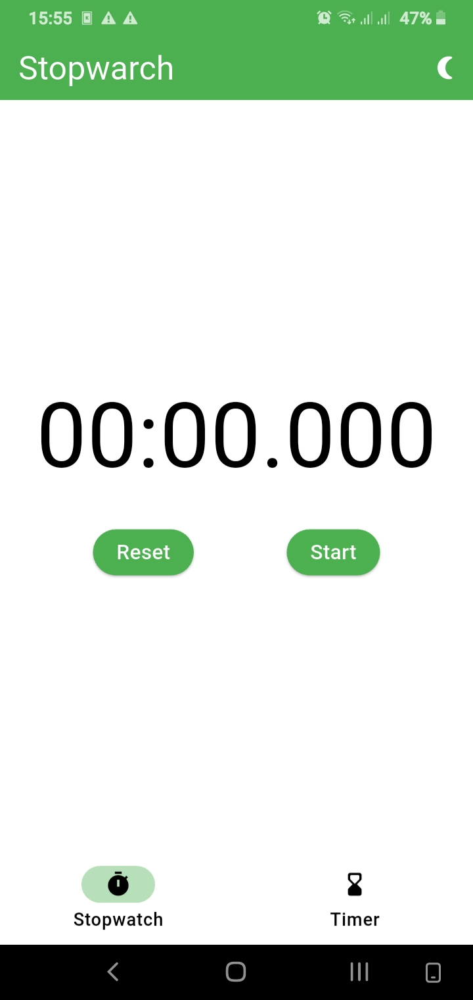
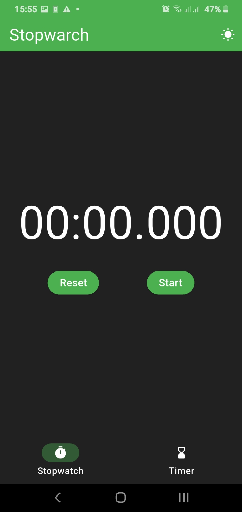
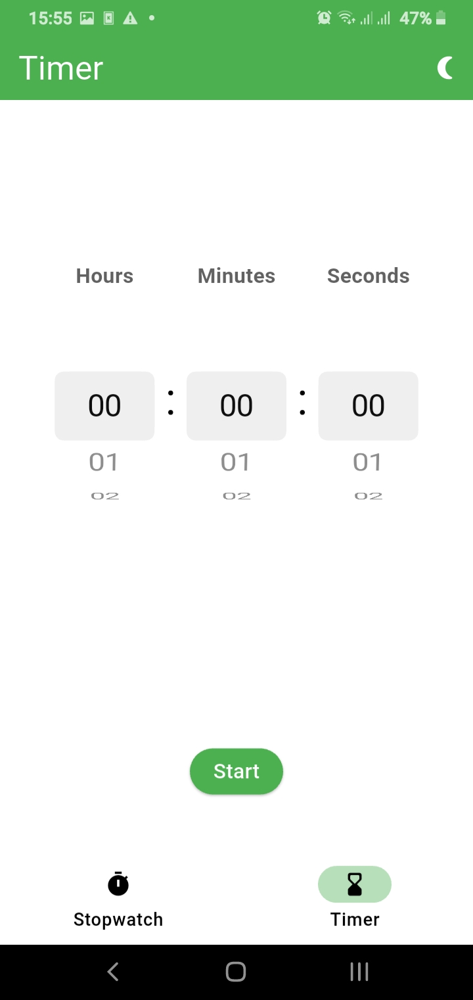
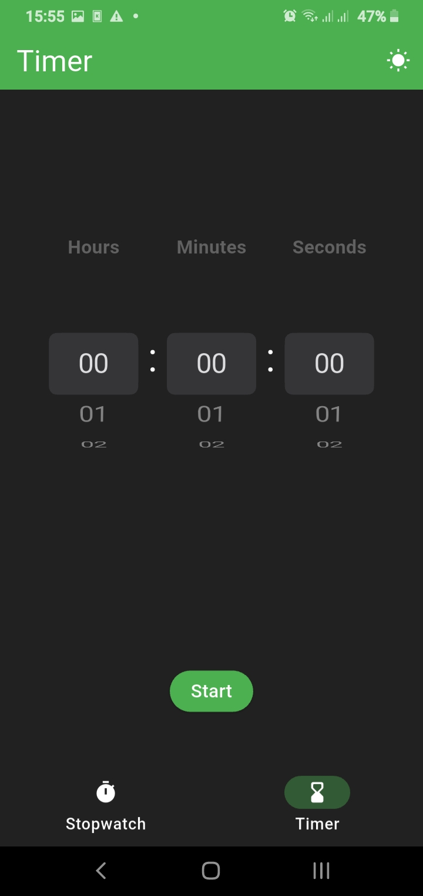

# Clock App

A simple clock app built with Flutter.

## Features

- Stopwatch
- Timer
- Pause and resume timer
- Circular progress indicator
- Sound notification when the timer finishes
- Repeating vibration notification when the timer finishes
- Customizable sound and vibration settings
- Keeps running when switching between pages
- Dark mode support

## Screenshots

| Page | Light Mode | Dark Mode |
|---|---|---|
| **Stopwatch** |  |  |
| **Timer** |  |  |

## Getting Started

Clone the repository:

```bash
git clone https://github.com/TunarAlasgarzade/clock_app.git
```

Navigate to the project directory:

```bash
cd clock_app
```

Install dependencies:

```bash
flutter pub get
```

Run the app:

```bash
flutter run
```

## Built With

- [Flutter](https://flutter.dev/)
- [Dart](https://dart.dev/)
- [audioplayers](https://pub.dev/packages/audioplayers)
- [vibration](https://pub.dev/packages/vibration)
- [shared_preferences](https://pub.dev/packages/shared_preferences)
- [provider](https://pub.dev/packages/provider)